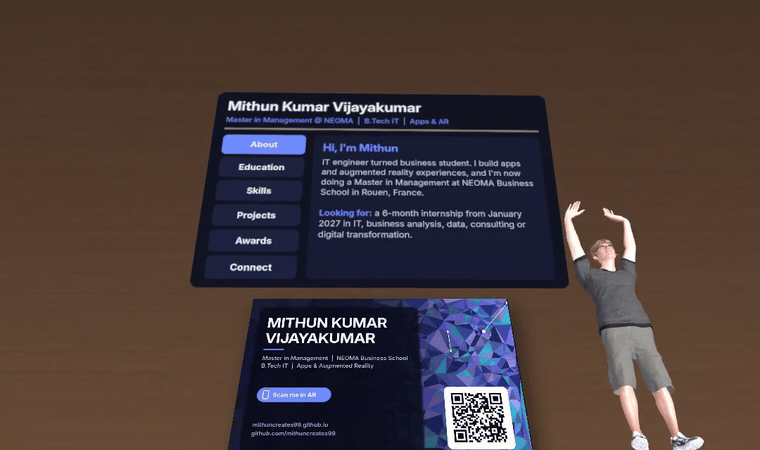
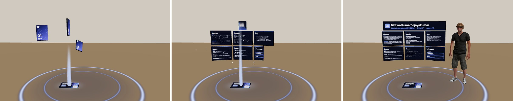
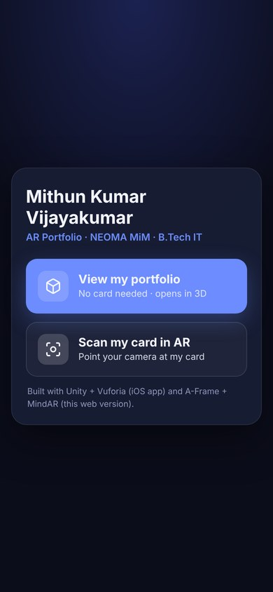
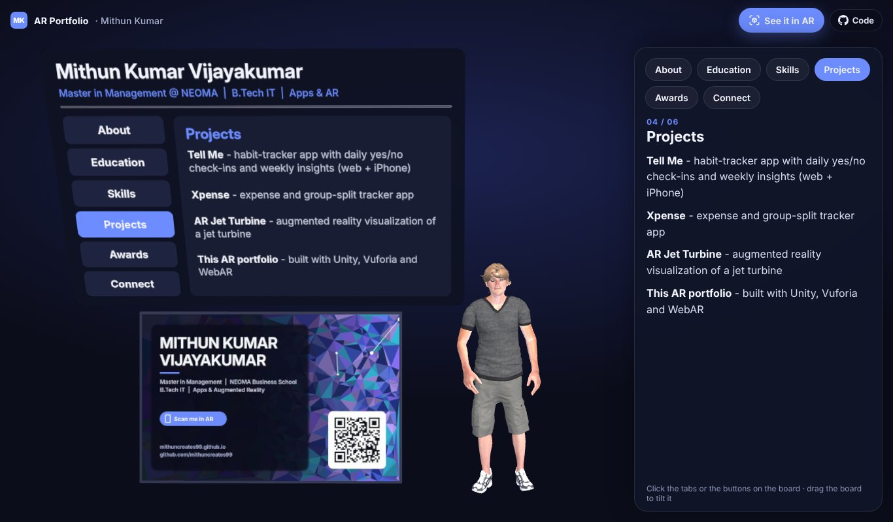
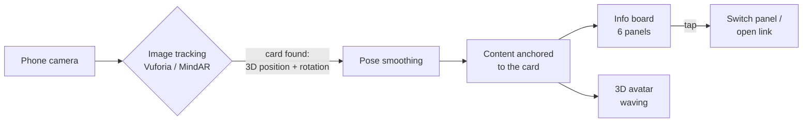

<div align="center">

# AR Portfolio

**Scan my card, and my CV comes alive.**
An augmented-reality business card: point a phone at it and an interactive portfolio board and a waving 3D avatar appear on top of it. No card? Open the link and the same portfolio appears in 3D.

[](https://mithuncreates99.github.io/ar-portfolio/)




</div>

---

## Try it

Open **[mithuncreates99.github.io/ar-portfolio](https://mithuncreates99.github.io/ar-portfolio/)** on your phone and tap **See it in AR**. No app, no card: point at the floor and the portfolio unfolds in your room. On a laptop, the same button shows a QR code to open it on your phone.

| | **See it in AR** | **View in 3D** | **Scan my card** |
|---|---|---|---|
| **Needs** | A phone, nothing else | Any browser | My card (printed or on another screen) |
| **What happens** | The card slams onto your floor, the six sections launch out of it as closed books and burst open into a standing display, then the avatar beams in. Walk around it, pinch to resize. | The board, card and avatar in 3D. Drag to turn, pinch or scroll to zoom, tap the buttons. | The board appears on top of the real card and follows it |
| **Runs on** | iPhone: AR Quick Look (USDZ) · Android: Scene Viewer (glTF) | Web (A-Frame) | Web (MindAR) or the iOS app (Vuforia) |
| **Link** | [Open](https://mithuncreates99.github.io/ar-portfolio/) | [`#view`](https://mithuncreates99.github.io/ar-portfolio/#view) | [`scan.html`](https://mithuncreates99.github.io/ar-portfolio/scan.html) |



<p>
  
  &nbsp;
  
</p>

To try the card scan without the printed card, open the card image below on another screen and scan it ([printable PDF](docs/assets/card-print.pdf)).


## What it does

- **Recognises a printed business card** through the phone camera and tracks it in 3D, so the content stays attached to the card as you move.
- **Shows an interactive portfolio board** above the card with six sections: About, Education, Skills, Projects, Awards and Connect. Tap a button to switch panels.
- **Opens links** to my portfolio website and GitHub straight from the AR view.
- **Places a 3D avatar** next to the card that waves at the viewer.
- **Markerless AR, no app:** on any recent iPhone or Android phone, the portfolio unfolds on a real floor or table with a short animated reveal. A button inside the AR view opens my portfolio website.
- **Works without a camera too:** a 3D view of the same scene for laptops and in-app browsers where the camera is blocked (for example inside LinkedIn).
- **Runs as an app and on the web:** a native **iOS app** (Unity + Vuforia) and a **web page** that needs no install (MindAR + A-Frame).

## How it works



1. **Image target.** The card design was made for tracking: a high-contrast low-poly pattern gives the tracker many corners to lock onto. It scores the maximum **5/5 rating** in Vuforia's Target Manager.
2. **Tracking.** Every camera frame, the tracker finds the card's features and computes its 3D pose relative to the camera.
3. **Anchoring.** All AR content is parented to the tracked card, so it moves with it. Content is only shown while the card is actually tracked.
4. **Interaction.** The board is a world-space UI. Taps are ray-cast from the AR camera, so buttons work on the card in 3D.

## Tech stack

| | Native app | Web version |
|---|---|---|
| **Engine** | Unity 6.3 LTS (URP) | A-Frame 1.5 (three.js) |
| **Tracking** | Vuforia Engine 11.4 (image target) | Markerless: AR Quick Look (iPhone) and Scene Viewer (Android); image target: MindAR 1.2; plus a no-camera 3D view |
| **Language** | C# | JavaScript, HTML/CSS |
| **UI** | uGUI + TextMesh Pro, world-space canvas | Textured planes + ray-cast hotspots |
| **Avatar** | Mixamo character, Humanoid rig, Animator | glTF 2.0 with WebP textures, animation mixer |
| **Platform** | iOS (Xcode) | Any modern browser, phone or desktop, hosted on GitHub Pages |

## Engineering highlights

- **One-click scene builder.** A custom Unity editor tool (`AR Portfolio → Build Everything`) generates the whole AR scene from a single content file: the board, buttons, panels, links, the Home screen and the iOS player settings. Updating the portfolio means editing text, not rebuilding UI by hand.
- **Smoother tracking.** Camera tracking jitters by a few millimetres every frame, and that wobble is magnified on content floating above the card. A frame-rate-independent exponential smoothing component (`PoseSmoother`) steadies the content, and snaps instantly when the card is re-acquired so it never lags behind.
- **No "ghost" content.** Extended tracking kept the board visible after the card left the view, drifting on devices without motion sensors. Content is now shown only while the card is actually tracked.
- **Avatar pipeline.** Mixamo characters arrive with textures packed inside the FBX. An editor step unpacks and re-links them in Unity. For the web, the character is converted to glTF with 512 px WebP textures: **28 MB → 1.8 MB** with the animation intact.
- **Two delivery channels.** The native app gives the best tracking. The web version removes the install barrier, so a recruiter can try it in seconds from a link.
- **Markerless AR from a script.** The reveal (card drop, shockwave, light beams, books opening, banner unroll, avatar beam-in) is generated in code with three.js, baked into a single 30 s animation clip and exported twice: glTF for Android Scene Viewer and USDZ for iPhone AR Quick Look (converted with Blender's Python API). Every effect is a pure transform animation, because neither format supports opacity animation or billboards, so fades are done with scale. Both files pass the glTF and USD validators, and `tools/ar/build.sh` rebuilds them from the portfolio text in one command.
- **One scene, three ways in on the web.** The AR page and the 3D view share the same board code (`docs/js/board.js`), so both always show the same content. In the 3D view, orbit controls handle drag and pinch, and taps are ray-cast separately so a drag that ends on a button never presses it. The camera framing adapts to the screen: on tall phone screens the avatar moves next to the card so the board can use the full width.

## Project structure

```
ar-portfolio/
├── Assets/
│   ├── ARPortfolio/
│   │   ├── Editor/
│   │   │   ├── ARPortfolioBuilder.cs   # "AR Portfolio" menu: builds scene, adds avatar, fixes textures
│   │   │   └── PortfolioContent.cs     # ← all the portfolio text and links live here
│   │   └── Scripts/
│   │       ├── PanelSwitcher.cs        # one panel at a time, highlights the active button
│   │       ├── OpenLinks.cs            # opens URLs from AR buttons
│   │       ├── PoseSmoother.cs         # calms tracking jitter
│   │       ├── FaceCamera.cs           # keeps the avatar turned towards the viewer
│   │       ├── SceneLoader.cs          # Home screen → AR scene
│   │       └── Spin.cs
│   ├── Scenes/                         # Home.unity, SampleScene.unity (AR)
│   └── StreamingAssets/Vuforia/        # compiled image-target database for the card
├── Packages/ · ProjectSettings/        # Unity project configuration
├── docs/                               # Web version, served by GitHub Pages
│   ├── index.html                      # welcome screen (See it in AR / View in 3D) + 3D view
│   ├── scan.html                       # AR mode: scan the card with the camera
│   ├── js/
│   │   ├── board.js                    # shared: board panels and tappable buttons
│   │   ├── view.js                     # 3D view: framing, drag/pinch, taps
│   │   └── ar.js                       # See it in AR: Quick Look / Scene Viewer / QR on laptops
│   ├── assets/                         # board panels, card, avatar (GLB), MindAR target
│   │   └── ar/                         # portfolio.usdz (iPhone) + portfolio.glb (Android)
│   ├── libs/                           # A-Frame, MindAR, aframe-extras, orbit controls (MIT)
│   └── media/                          # README images
└── tools/
    ├── boards/make_boards.py           # renders the board panels + board.json from the portfolio text
    └── ar/build.sh                     # rebuilds the markerless AR files (three.js bake → glTF → USDZ)
```

## Run it yourself

### Native app (Unity + Vuforia)

**Requirements:** Unity **6.3 LTS** with iOS Build Support, Xcode, a free [Vuforia developer account](https://developer.vuforia.com).

1. Clone the repo and open it in Unity 6.3 LTS.
2. Download **Vuforia Engine for Unity** (`add-vuforia-package-11-4-4.unitypackage`) from the Vuforia developer portal and import it. It's not stored in this repo.
3. Create a free **Basic license key** in the portal, select **ARCamera** → *Open Vuforia Engine Configuration*, and paste the key. Keys are never committed.
4. *(Optional)* Get the avatar: on [Mixamo](https://www.mixamo.com) pick a character with the **Waving** animation and download it as **FBX for Unity, With Skin**. Drop it into `Assets/`, select it, and run **AR Portfolio → Add Avatar**.
5. Edit your text and links in `Assets/ARPortfolio/Editor/PortfolioContent.cs`, then run **AR Portfolio → Build Everything**.
6. Press **Play** and hold the card in front of your webcam. To deploy, use **File → Build Profiles → iOS → Build**, then open the Xcode project, choose your team under *Signing & Capabilities*, and run it on your iPhone.

### Web version

The `docs/` folder is a static site with no build step. Serve it over HTTPS or from `localhost` (browsers only allow the camera there), then open `index.html` for the 3D view or `scan.html` for AR:

```bash
npx serve docs
```

To use a different card, compile it into a new `targets.mind` with the [MindAR image target compiler](https://hiukim.github.io/mind-ar-js-doc/tools/compile) and replace `docs/assets/targets.mind`.

### Markerless AR files

`docs/assets/ar/portfolio.usdz` (iPhone) and `portfolio.glb` (Android) are generated. After editing the portfolio text in `tools/boards/make_boards.py`, rebuild them with:

```bash
BLENDER_PY=python3 tools/ar/build.sh   # needs Pillow, Node + Playwright, and `pip install bpy`
```

## Roadmap

- [ ] Markerless mode in the native app (AR Foundation plane detection) with tappable buttons
- [ ] Android build (APK)
- [ ] LinkedIn and email buttons
- [ ] Content loaded from a JSON file or CMS, so the board updates without a new build
- [ ] Short intro animation when the card is first detected

## Credits

- **Vuforia Engine** © PTC Inc., used under the Vuforia developer license. Not included in this repository.
- **[MindAR](https://github.com/hiukim/mind-ar-js)**, **[A-Frame](https://aframe.io)**, **[aframe-extras](https://github.com/c-frame/aframe-extras)** and **[aframe-orbit-controls](https://github.com/supermedium/superframe)**, MIT. See `docs/libs/THIRD-PARTY-NOTICES.md`.
- AR files built with **[three.js](https://threejs.org)** (MIT), **[glTF Transform](https://gltf-transform.dev)** (MIT) and **[Blender](https://www.blender.org)**'s Python API (GPL, used as a build tool only).
- **Character "Remy" and "Waving" animation** from [Adobe Mixamo](https://www.mixamo.com), used under Mixamo's terms. The original FBX files are not redistributed here; the web demo contains an optimised version.
- Card typography: [Inter](https://rsms.me/inter/) (SIL Open Font License).

## Author

**Mithun Kumar Vijayakumar**: Master in Management student at NEOMA Business School, B.Tech in Information Technology, Pega Certified System Architect.

[Portfolio](https://mithuncreates99.github.io) · [GitHub](https://github.com/mithuncreates99)

## License

The source code in this repository is released under the [MIT License](LICENSE). Third-party libraries and assets keep their own licenses, as listed above.
