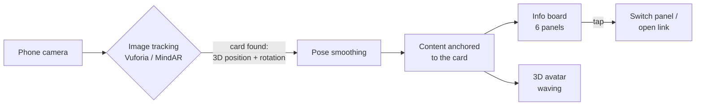

<div align="center">

# AR Portfolio

**Scan my card, and my CV comes alive.**
An augmented-reality business card: point a phone at it and an interactive portfolio board and a waving 3D avatar appear on top of it.

[](https://mithuncreates99.github.io/ar-portfolio/)


</div>

---

## Try it

1. Open **[mithuncreates99.github.io/ar-portfolio](https://mithuncreates99.github.io/ar-portfolio/)** on your phone (Safari on iPhone, Chrome on Android).
2. Tap **Start** and allow the camera.
3. Point the camera at the card. No card? Open the image below on another screen and scan that.


## What it does

- **Recognises a printed business card** through the phone camera and tracks it in 3D, so the content stays attached to the card as you move.
- **Shows an interactive portfolio board** above the card with six sections: About, Education, Skills, Projects, Awards and Connect. Tap a button to switch panels.
- **Opens links** to my portfolio website and GitHub straight from the AR view.
- **Places a 3D avatar** next to the card that waves at the viewer.
- **Runs two ways:** as a native **iOS app** (Unity + Vuforia) and as a **web page** that needs no install (MindAR + A-Frame), so anyone can try it from a link.

## How it works



1. **Image target.** The card design was made for tracking: a high-contrast low-poly pattern gives the tracker many corners to lock onto. It scores the maximum **5/5 rating** in Vuforia's Target Manager.
2. **Tracking.** Every camera frame, the tracker finds the card's features and computes its 3D pose relative to the camera.
3. **Anchoring.** All AR content is parented to the tracked card, so it moves with it. Content is only shown while the card is actually tracked.
4. **Interaction.** The board is a world-space UI. Taps are ray-cast from the AR camera, so buttons work on the card in 3D.

## Tech stack

| | Native app | Web version |
|---|---|---|
| **Engine** | Unity 6.3 LTS (URP) | A-Frame 1.5 (three.js) |
| **Tracking** | Vuforia Engine 11.4 (image target) | MindAR 1.2 (image target) |
| **Language** | C# | JavaScript, HTML/CSS |
| **UI** | uGUI + TextMesh Pro, world-space canvas | Textured planes + ray-cast hotspots |
| **Avatar** | Mixamo character, Humanoid rig, Animator | glTF 2.0 with WebP textures, animation mixer |
| **Platform** | iOS (Xcode) | Any modern mobile browser, hosted on GitHub Pages |

## Engineering highlights

- **One-click scene builder.** A custom Unity editor tool (`AR Portfolio → Build Everything`) generates the whole AR scene from a single content file: the board, buttons, panels, links, the Home screen and the iOS player settings. Updating the portfolio means editing text, not rebuilding UI by hand.
- **Smoother tracking.** Camera tracking jitters by a few millimetres every frame, and that wobble is magnified on content floating above the card. A frame-rate-independent exponential smoothing component (`PoseSmoother`) steadies the content, and snaps instantly when the card is re-acquired so it never lags behind.
- **No "ghost" content.** Extended tracking kept the board visible after the card left the view, drifting on devices without motion sensors. Content is now shown only while the card is actually tracked.
- **Avatar pipeline.** Mixamo characters arrive with textures packed inside the FBX. An editor step unpacks and re-links them in Unity. For the web, the character is converted to glTF with 512 px WebP textures: **28 MB → 1.8 MB** with the animation intact.
- **Two delivery channels.** The native app gives the best tracking. The web version removes the install barrier, so a recruiter can try it in seconds from a link.

## Project structure

```
ar-portfolio/
├── Assets/
│   ├── ARPortfolio/
│   │   ├── Editor/
│   │   │   ├── ARPortfolioBuilder.cs   # "AR Portfolio" menu: builds scene, adds avatar, fixes textures
│   │   │   └── PortfolioContent.cs     # ← all the portfolio text and links live here
│   │   └── Scripts/
│   │       ├── PanelSwitcher.cs        # one panel at a time, highlights the active button
│   │       ├── OpenLinks.cs            # opens URLs from AR buttons
│   │       ├── PoseSmoother.cs         # calms tracking jitter
│   │       ├── FaceCamera.cs           # keeps the avatar turned towards the viewer
│   │       ├── SceneLoader.cs          # Home screen → AR scene
│   │       └── Spin.cs
│   ├── Scenes/                         # Home.unity, SampleScene.unity (AR)
│   └── StreamingAssets/Vuforia/        # compiled image-target database for the card
├── Packages/ · ProjectSettings/        # Unity project configuration
└── docs/                               # Web version, served by GitHub Pages
    ├── index.html
    ├── assets/                         # board panels, card, avatar (GLB), MindAR target
    ├── libs/                           # A-Frame, MindAR, aframe-extras (MIT)
    └── media/                          # README images
```

## Run it yourself

### Native app (Unity + Vuforia)

**Requirements:** Unity **6.3 LTS** with iOS Build Support, Xcode, a free [Vuforia developer account](https://developer.vuforia.com).

1. Clone the repo and open it in Unity 6.3 LTS.
2. Download **Vuforia Engine for Unity** (`add-vuforia-package-11-4-4.unitypackage`) from the Vuforia developer portal and import it. It's not stored in this repo.
3. Create a free **Basic license key** in the portal, select **ARCamera** → *Open Vuforia Engine Configuration*, and paste the key. Keys are never committed.
4. *(Optional)* Get the avatar: on [Mixamo](https://www.mixamo.com) pick a character with the **Waving** animation and download it as **FBX for Unity, With Skin**. Drop it into `Assets/`, select it, and run **AR Portfolio → Add Avatar**.
5. Edit your text and links in `Assets/ARPortfolio/Editor/PortfolioContent.cs`, then run **AR Portfolio → Build Everything**.
6. Press **Play** and hold the card in front of your webcam. To deploy, use **File → Build Profiles → iOS → Build**, then open the Xcode project, choose your team under *Signing & Capabilities*, and run it on your iPhone.

### Web version

The `docs/` folder is a static site with no build step. Serve it over HTTPS or from `localhost`, since browsers only allow the camera there:

```bash
npx serve docs
```

To use a different card, compile it into a new `targets.mind` with the [MindAR image target compiler](https://hiukim.github.io/mind-ar-js-doc/tools/compile) and replace `docs/assets/targets.mind`.

## Roadmap

- [ ] Android build (APK)
- [ ] LinkedIn and email buttons
- [ ] Content loaded from a JSON file or CMS, so the board updates without a new build
- [ ] Short intro animation when the card is first detected

## Credits

- **Vuforia Engine** © PTC Inc., used under the Vuforia developer license. Not included in this repository.
- **[MindAR](https://github.com/hiukim/mind-ar-js)**, **[A-Frame](https://aframe.io)** and **[aframe-extras](https://github.com/c-frame/aframe-extras)**, MIT. See `docs/libs/THIRD-PARTY-NOTICES.md`.
- **Character "Remy" and "Waving" animation** from [Adobe Mixamo](https://www.mixamo.com), used under Mixamo's terms. The original FBX files are not redistributed here; the web demo contains an optimised version.
- Card typography: [Inter](https://rsms.me/inter/) (SIL Open Font License).

## Author

**Mithun Kumar Vijayakumar**: Master in Management student at NEOMA Business School, B.Tech in Information Technology, Pega Certified System Architect.

[Portfolio](https://mithuncreates99.github.io) · [GitHub](https://github.com/mithuncreates99)

## License

The source code in this repository is released under the [MIT License](LICENSE). Third-party libraries and assets keep their own licenses, as listed above.
